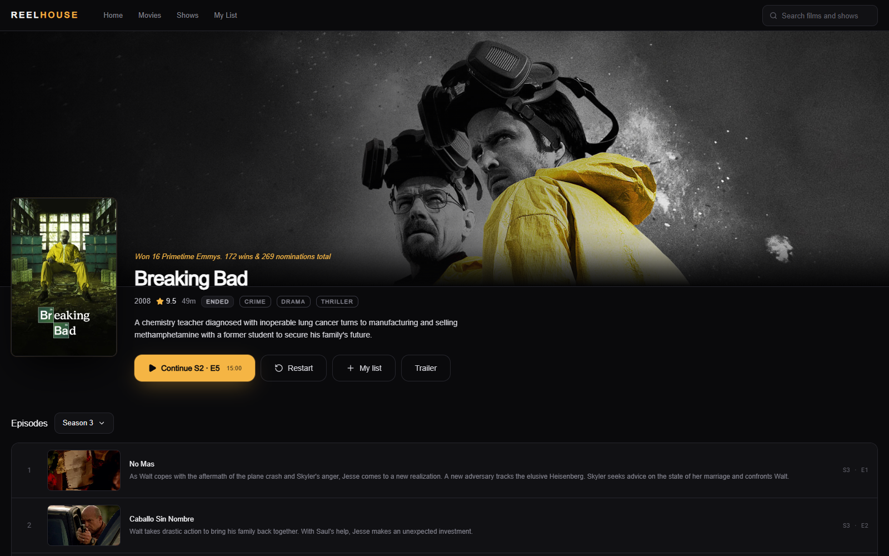
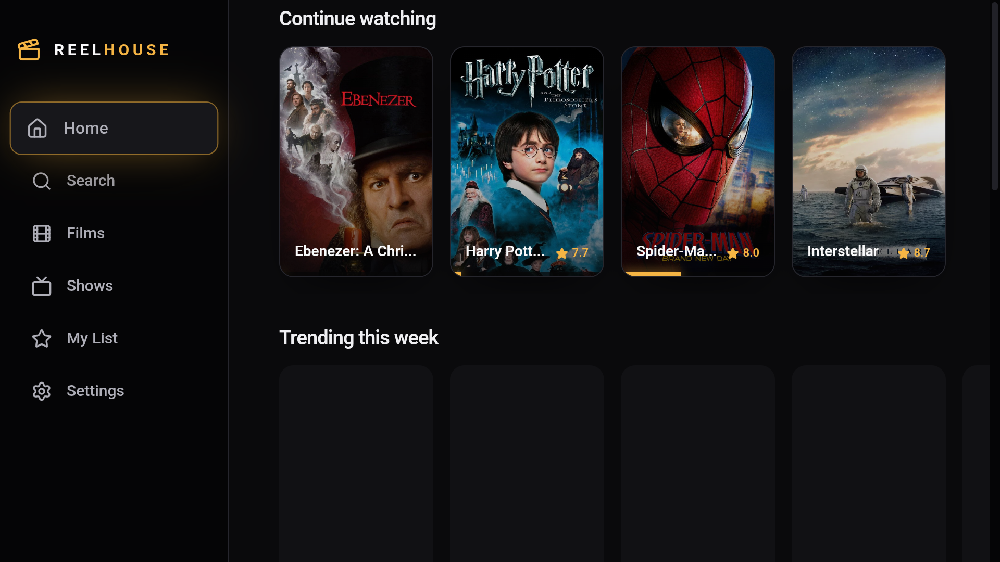

<div align="center">
  

  <h1>Reelhouse</h1>

  <p><strong>A cinematic home for films and television.</strong></p>

  <p>Discover something worth watching, keep your personal library close, and pick up exactly where you left off—on Windows and Android TV.</p>

  [](https://github.com/Braedennn/Reelhouse/releases/latest)
  [](https://github.com/Braedennn/Reelhouse/releases/latest)
  [](https://github.com/Braedennn/Reelhouse/releases/latest)
  [](https://github.com/Braedennn/Reelhouse/releases)

  **[Download Reelhouse](https://github.com/Braedennn/Reelhouse/releases/latest)** · **[What’s new](#whats-new-in-110)** · **[Installation](#installation)** · **[Controls](#controls)**

  
</div>

## Your library, beautifully organized

Reelhouse brings catalog discovery, playback, and personal watch history into one focused, distraction-free experience. No Reelhouse account is required.

<table>
  <tr>
    <td width="50%">
      <h3>Find your next favorite</h3>
      <p>Browse films and series, search the catalog, explore genres, and view rich title, cast, season, and episode details.</p>
    </td>
    <td width="50%">
      <h3>Continue without missing a beat</h3>
      <p>Resume films and episodes from your library, track completed episodes, and move automatically to the next episode—including across seasons.</p>
    </td>
  </tr>
  <tr>
    <td>
      <h3>Make it yours</h3>
      <p>Save titles, organize your shelf as planned, watching, watched, or dropped, and keep playback preferences on your device.</p>
    </td>
    <td>
      <h3>A player built for the couch</h3>
      <p>Adjust quality, subtitles, speed, volume, and display settings. Android TV uses native Media3 playback with a remote-friendly interface.</p>
    </td>
  </tr>
</table>

## Download

Get the latest builds from **[Reelhouse 1.1.0](https://github.com/Braedennn/Reelhouse/releases/tag/v1.1.0)**.

| Platform | Download | Package | Notes |
| --- | --- | --- | --- |
| **Windows Desktop** | **[Download for Windows x64](https://github.com/Braedennn/Reelhouse/releases/download/v1.1.0/Reelhouse.Setup.exe)** | `Reelhouse.Setup.exe` | Desktop installer |
| **Android TV** | **[Download for Android TV](https://github.com/Braedennn/Reelhouse/releases/download/v1.1.0/reelhouse-tv.apk)** | `reelhouse-tv.apk` | Non-debuggable, development-signed APK |

> **Windows TV:** The former Windows TV prototype is not distributed or supported. The TV release is for **Android TV**.

## Installation

### Windows Desktop

1. Download `Reelhouse.Setup.exe`.
2. Open the installer and follow the setup steps.
3. Launch **Reelhouse** from the Start menu or the installed shortcut.

An internet connection is required for catalog metadata, artwork, source discovery, and playback. The Windows installer is currently unsigned, so Windows SmartScreen may display a publisher warning.

### Android TV

1. Download `reelhouse-tv.apk` onto your Android TV device or a computer connected to it.
2. Allow installation from your chosen file manager or sideloading app when Android prompts you.
3. Install the APK and open **Reelhouse** from the TV app row.

To install with ADB instead:

```sh
adb connect YOUR_TV_IP:5555
adb install -r reelhouse-tv.apk
```

The APK is built in release mode with Android debugging disabled and signed with the same development certificate used for v1.0.0. It is intended for direct installation and is not a Google Play or production-upload-signed release.

## Android TV

A full-screen, 10-foot interface with clear focus states, four-poster browsing rows, and native playback controls.

<div align="center">
  
</div>

## Controls

### Windows keyboard

| Action | Keys |
| --- | --- |
| Play / pause | `Space` or `K` |
| Seek backward / forward 10 seconds | `J` / `L` or `←` / `→` |
| Volume | `↑` / `↓` |
| Mute | `M` |
| Fullscreen | `F` |
| Theater mode | `T` |
| Picture in picture | `P` |
| Fill screen | `Z` |
| Subtitles | `C` |
| Jump to a position | `0`–`9` |

### Android TV remote

| Action | Control |
| --- | --- |
| Move focus | D-pad arrows |
| Seek backward / forward 10 seconds | D-pad `←` / `→` during playback, including on the progress bar |
| Select / play / pause | Enter or the remote’s select button |
| Go back | Back |
| Playback options | Open the on-screen playback settings control |

## What’s new in 1.1.0

- More reliable Auto source selection with adaptive HLS and efficient fallbacks
- StreamPlay’s Vidlink source added natively with quality variants and captions
- Larger Android TV playback buffer and automatic English audio preference
- Exact 10-second D-pad seeking on the video surface and focused progress bar
- PlavioHD, StreamPlay · Vidlink, and Internet Archive support on Windows

See the complete **[changelog](CHANGELOG.md)**.

## Privacy and local data

Saved titles, shelf states, playback progress, and preferences stay on your device. Reelhouse has no account system and includes no advertising or analytics SDK.

Reelhouse is not an offline application. Search, metadata, artwork, source discovery, health checks, subtitles, and playback contact third-party services, which can receive request details and your network address.

Use **Settings → Privacy & data → Clear local data** to remove the app’s local library, progress, and preferences. Read the full **[Privacy Policy](PRIVACY.md)** for platform-specific details and limitations.

## Availability and third-party content

Reelhouse does not host the catalog’s media. Metadata, artwork, streams, subtitles, and external links are supplied by third parties. Provider availability, stream quality, and catalog information can change or become unavailable. Third-party terms and content rights apply.

## Support

- **[Report a bug](https://github.com/Braedennn/Reelhouse/issues/new?template=bug_report.yml)** — include your platform, app version, and reproduction steps.
- **[Request a feature](https://github.com/Braedennn/Reelhouse/issues/new?template=feature_request.yml)** — describe the problem you want Reelhouse to solve.
- **[Release history](https://github.com/Braedennn/Reelhouse/releases)** — downloads, release notes, and checksums.

Please do not attach credentials, provider configuration secrets, signed media URLs, access tokens, or personal data to a public issue.

---

<div align="center">
  <strong>Reelhouse</strong><br />
  Windows Desktop · Android TV<br /><br />
  This repository is the official download and documentation hub for Reelhouse.<br />
  Application source code is not published here.
</div>
